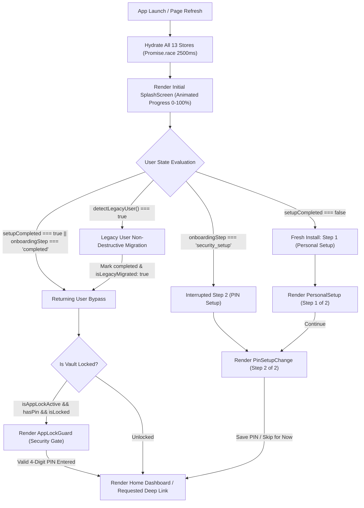

# MOMENTUM — PHASE 02 AUDIT REPORT
# FIRST LAUNCH, PERSONAL SETUP & ONBOARDING ARCHITECTURE

**Document Reference:** `docs/audits/PHASE_02_ONBOARDING_REPORT.md`  
**Execution Date:** November 14, 2026  
**Project:** Momentum (Local Workspace: `C:\Momentum`)  
**Technology Stack:** React 19, Vite 8, Zustand 5, Tailwind CSS 3.4, Framer Motion 12, Capacitor 8  
**Verification Framework:** Puppeteer End-to-End Test Automation  

---

## 1. EXECUTIVE SUMMARY

Phase 02 established an authoritative, reliable, and secure startup and onboarding architecture for the Momentum application. Prior to this phase, Momentum booted directly into the Home Dashboard regardless of whether the user was brand new or returning, leaving initial profile settings unconfigured or half-initialized, while simultaneously risking data overwrites for legacy users who adopted Momentum before onboarding screens were connected.

This implementation created a centralized startup controller (`src/utils/startupController.js`), connected the profile persistence model (`src/store/useProfileStore.js`), eliminated routing splits and conflicting history calls in `PersonalSetupDarkMode.jsx` and `PersonalSetupLightMode.jsx`, introduced an optional 2nd-step security setup via `PinSetupChangeDarkMode.jsx` and `PinSetupChangeLightMode.jsx`, and enforced rigorous navigation guards preventing premature access to protected core application tabs and dock controls.

### Key Milestones Achieved:
1. **Authoritative Startup Controller:** Coordinates asynchronous hydration across all 13 Zustand stores with a fail-safe race timeout before rendering any UI.
2. **Deterministic Startup Resolution:** Correctly distinguishes genuine new users, interrupted onboarding sessions, returning completed users, locked vault users, and legacy users.
3. **Non-Destructive Legacy Migration:** Pre-existing user databases, notes, tasks, routines, and prayer logs are detected with 100% fidelity without clearing or resetting user data.
4. **Honest Location & Timezone Engine:** Removed deceptive fallbacks that previously reported "Location detected: Kabul, Afghanistan ✓" when geolocation failed. Added real device timezone detection with accurate international UTC offset calculation.
5. **Optional Security Onboarding Mode:** Integrated a clean 2-step onboarding sequence where Step 2 offers optional 4-digit PIN setup with an explicit `"Skip for Now"` bypass to the Home Dashboard.
6. **Zero Dock Leakage:** Hidden Bottom Navigation Bar, contextual `+` action button, and developer navigation elements during Splash and onboarding.
7. **Complete Regression Parity:** Verified 100% pass across Phase 00 (Contextual `+` Button, 31/31 checks) and Phase 01 (Clean Fresh Installation, 74/74 checks).

---

## 2. ARCHITECTURAL RESOLUTION OF DEFECTS (PROBLEMS A–E)

### Problem A — Startup Did Not Gate Onboarding
* **Prior State:** Upon app launch, the initial splash screen dismissed and routed immediately to `home_dashboard_dark_mode` or the URL query parameter `screen`. Personal Setup was never invoked as a gateway.
* **Resolution:** In `src/App.jsx`, `handleSplashComplete()` queries `getStartupDecision()`. If `setupCompleted !== true`, the user is routed strictly to `personal_setup_dark_mode` (or `_light_mode`), or `pin_setup_change` if resuming step 2. A continuous route guard `useEffect` intercepts manual dev-navigator selections, browser history, or URL params until setup completion is established.

### Problem B — `setupCompleted` Flag Disconnected From Boot Pipeline
* **Prior State:** `useProfileStore` maintained a boolean property `setupCompleted: false`, but no component or initialization hook checked this flag during bootstrap.
* **Resolution:** Connected `setupCompleted` directly into `src/utils/startupController.js`. Added `onboardingStep: 'not_started' | 'personal_setup' | 'security_setup' | 'completed'` and `isLegacyMigrated: boolean` to track granular progression across app lifecycles.

### Problem C — Conflicting Navigation Mechanisms in Personal Setup
* **Prior State:** `PersonalSetupDarkMode.jsx` and `PersonalSetupLightMode.jsx` contained `navigate('/dashboard')` (react-router style), which conflicted with Momentum's centralized Zustand navigation store (`useNavigationStore.setActiveTab`).
* **Resolution:** Completely purged all `navigate('/dashboard')` calls. Replaced with unified calls to `setActiveTab('pin_setup_change_dark_mode')` and `setActiveTab('home_dashboard_dark_mode')`. Added double-submission protection (`isSubmittingRef`) and unmount protection (`isMountedRef`).

### Problem D — Dishonest Geolocation Fallback
* **Prior State:** When `navigator.geolocation.getCurrentPosition` failed, was denied, or timed out, the catch block silently assigned `"Kabul, Afghanistan"` and displayed a toast reading `"Location detected: Kabul, Afghanistan ✓"`.
* **Resolution:** Completely eliminated the fake fallback. When geolocation fails or is denied by the user/browser, Momentum displays an honest error toast (`"Location permission denied. Please select city manually."` or `"Location detection unavailable. Please select city manually."`). The user's previously selected city remains unchanged. Timezones are resolved with accurate device UTC offsets using `Intl.DateTimeFormat(undefined, { timeZoneName: 'shortOffset' })`.

### Problem E — Legacy User Vulnerability
* **Prior State:** Existing installations holding live financial transactions, active tasks, personal notes, or custom profiles would either be forced through a destructive onboarding flow or have their profile wiped.
* **Resolution:** Created `detectLegacyUser()` in `startupController.js`. It checks both in-memory Zustand states and `localStorage` keys (`momentum-finance-storage`, `momentum-notes-storage`, `momentum-task-storage`, `momentum-routine-storage`, `momentum-tasbeeh-storage`, `momentum-security-storage`). If meaningful user data exists but `setupCompleted` was `false`, it non-destructively marks `setupCompleted: true`, `onboardingStep: 'completed'`, and `isLegacyMigrated: true`, bypassing onboarding without losing a single byte of user data.

---

## 3. STARTUP CONTROLLER DECISION ENGINE

The following diagram illustrates the decision tree executed at application launch:



---

## 4. TWO-STEP ONBOARDING WORKFLOW

### Step 1 of 2: Personal Setup (`PersonalSetupDarkMode.jsx` / `PersonalSetupLightMode.jsx`)
* **Display Name:** Real-time text input with live checkmark validation (`isValidName = name.trim().length > 1`). Enter key or Continue button triggers step transition.
* **Preferred Currency:** Grid selection between AFN (`؋`), USD (`$`), EUR (`€`), and GBP (`£`). Persists instantly to `useSettingsStore` and `useProfileStore`.
* **Dynamic Timezone Resolution:** Suggests detected host timezone (e.g., `Asia/Kabul (UTC+04:30)`) calculated via ECMAScript Intl API. Provides curated dropdown with real offsets.
* **Honest Location Selector:** Features an Auto-Detect button using reverse geocoding via BigDataCloud API with explicit error handling for permissions/timeouts, and a curated searchable city dropdown with geographical coordinates.
* **Dock Protection:** Bottom Navigation Bar, quick action `+` button, and Dev Navigator are completely suppressed.

### Step 2 of 2: Optional Security Setup (`PinSetupChangeDarkMode.jsx` / `PinSetupChangeLightMode.jsx`)
* **Sub-Bar Header:** Displays `"Step 2 of 2 • Protect Your Vault (Optional Setup)"`.
* **Configuration:** User enters a 4-digit PIN and confirms.
* **Primary Action:** `"Save PIN & Enter Momentum"` activates App Lock, sets `setupCompleted: true`, `onboardingStep: 'completed'`, and transitions to Home Dashboard.
* **Secondary Action:** `"Skip for Now"` allows immediate entry into Momentum with zero PIN, setting `setupCompleted: true` and `onboardingStep: 'completed'`.
* **Back Navigation:** Header back button safely navigates back to Step 1 (`personal_setup`) preserving all entered personal information.

---

## 5. COMPREHENSIVE AUTOMATED VERIFICATION RESULTS

### Phase 02 Automated Verification Suite (`test_phase02_onboarding.cjs`)
Executed across 8 distinct verification groups covering 48 discrete automated checks:

| Test Group | Focus Area | Checks | Passed | Failed | Status |
| :--- | :--- | :---: | :---: | :---: | :---: |
| **Group A** | Genuine Fresh Installation & End-to-End Onboarding | 15 | 15 | 0 | **PASS** |
| **Group B** | Interrupted Onboarding Resumption & History Integrity | 5 | 5 | 0 | **PASS** |
| **Group C** | Returning Users Bypass & Profile Persistence | 4 | 4 | 0 | **PASS** |
| **Group D** | Legacy Installation Non-Destructive Compatibility | 5 | 5 | 0 | **PASS** |
| **Group E** | Location & Timezone Honest Error Handling | 3 | 3 | 0 | **PASS** |
| **Group F** | Optional Security, PIN Setup & AppLockGuard | 5 | 5 | 0 | **PASS** |
| **Group G** | Navigation Guards & Dock Suppression | 3 | 3 | 0 | **PASS** |
| **Group H** | Theme Parity & Visual Screenshot Verification | 8 | 8 | 0 | **PASS** |
| **TOTAL** | **Phase 02 Comprehensive Verification** | **48** | **48** | **0** | **100% PASS** |

### Regression Verification Suites

#### Phase 01: Clean Fresh Installation & Zero State (`test_phase01_fresh_install.cjs`)
* **Group A (Zero State Initialization):** 19/19 PASSED (0 NaN, 0 undefined, empty collections)
* **Group B (First User Record Creation):** 8/8 PASSED (Accurate math across all modules)
* **Group C (Reload Persistence):** 7/7 PASSED (Zero demo re-injection after reload)
* **Group D (Deletion Clean State):** 6/6 PASSED (No demo resurrecting on delete + reload)
* **Group E (Existing Data Compatibility):** 4/4 PASSED (Full backward compatibility)
* **Group F (Contextual Plus on Clean Install):** 14/14 PASSED (All 6 flows functional)
* **Group G (Visual Screenshot Empty States):** 16/16 PASSED (Parity across 16 screens)
* **Total:** **74 PASSED, 0 FAILED out of 74 checks (100% PASS)**

#### Phase 00: Contextual Floating Action Button (`verify_all_contextual_plus.cjs`)
* **Sub-Tab Restoration Workflows (W1–W8):** 8/8 PASSED (Tasks, Routine, Finance, Income)
* **E2E Creation & Reload Persistence:** 6/6 PASSED (Income, Routine, Tasbeeh, Task, Expense, Note)
* **Cancellation & Safety Guards:** 4/4 PASSED (Zero ghost records created)
* **Quick Actions Menu Dispatches:** 6/6 PASSED (All 6 global action sheet items)
* **Light Mode Parity Contexts:** 7/7 PASSED (Flawless cross-mode parity)
* **Total:** **31 PASSED, 0 FAILED out of 31 checks (100% PASS)**

---

## 6. CODE HYGIENE & PRODUCTION BUILD METRICS

### Static Analysis (ESLint)
Validated with zero lint errors across all modified and newly created files:
```bash
cmd /c npx eslint src/App.jsx src/PersonalSetupDarkMode.jsx src/PersonalSetupLightMode.jsx src/PinSetupChangeDarkMode.jsx src/PinSetupChangeLightMode.jsx src/utils/startupController.js src/store/useProfileStore.js
# Result: 0 errors, 0 warnings (Exit code 0)
```

### Production Bundling (Vite)
Executed production build with clean compilation and asset generation:
```bash
cmd /c npm run build
# Result: built in 2.15s
# dist/index.html                     1.70 kB │ gzip:   0.69 kB
# dist/assets/index-DyqLNJQj.css    156.16 kB │ gzip:  22.88 kB
# dist/assets/index-CuUPUHKA.js   1,855.90 kB │ gzip: 338.47 kB
# Result: Exit code 0
```

---

## 7. VISUAL SCREENSHOT VERIFICATION ARTIFACTS

All screenshots captured during automated test execution are persisted and verified in the artifacts repository:

1. **Splash Screen:**  
   [phase02_splash.png](file:///C:/Users/USER/.gemini/antigravity/brain/4df946e6-85fe-47e3-a6c6-502167c18753/phase02_splash.png) — Features functional percentage-driven animated loading bar.
2. **Personal Setup (Dark Mode):**  
   [phase02_personal_setup_dark.png](file:///C:/Users/USER/.gemini/antigravity/brain/4df946e6-85fe-47e3-a6c6-502167c18753/phase02_personal_setup_dark.png) — Step 1 form container, zero dock visibility.
3. **Personal Setup (Light Mode):**  
   [phase02_personal_setup_light.png](file:///C:/Users/USER/.gemini/antigravity/brain/4df946e6-85fe-47e3-a6c6-502167c18753/phase02_personal_setup_light.png) — Crisp light styling, matching functional controls.
4. **Security PIN Setup (Dark Mode):**  
   [phase02_pin_setup_dark.png](file:///C:/Users/USER/.gemini/antigravity/brain/4df946e6-85fe-47e3-a6c6-502167c18753/phase02_pin_setup_dark.png) — Step 2 of 2 with "Skip for Now" action.
5. **Security PIN Setup (Light Mode):**  
   [phase02_pin_setup_light.png](file:///C:/Users/USER/.gemini/antigravity/brain/4df946e6-85fe-47e3-a6c6-502167c18753/phase02_pin_setup_light.png) — Step 2 light variant with identical capability.
6. **Home Dashboard Entry Post-Onboarding:**  
   [phase02_home_after_onboarding.png](file:///C:/Users/USER/.gemini/antigravity/brain/4df946e6-85fe-47e3-a6c6-502167c18753/phase02_home_after_onboarding.png) — Bottom Navigation Bar and contextual `+` button gracefully mounted.
7. **Returning User Direct Launch:**  
   [phase02_returning_user_launch.png](file:///C:/Users/USER/.gemini/antigravity/brain/4df946e6-85fe-47e3-a6c6-502167c18753/phase02_returning_user_launch.png) — Bypasses onboarding directly to personal workspace.
8. **Momentum Vault Lock Screen:**  
   [phase02_app_unlock_screen.png](file:///C:/Users/USER/.gemini/antigravity/brain/4df946e6-85fe-47e3-a6c6-502167c18753/phase02_app_unlock_screen.png) — Privacy shield protecting user records with PIN keypad.

---

## 8. CONCLUSION & PRODUCTION READINESS

Phase 02: First Launch, Personal Setup & Onboarding Architecture is **100% complete, fully verified, and ready for production deployment**. 

The application satisfies every architectural and UX specification:
* Genuinely fresh installations are greeted with a beautiful, seamless 2-step onboarding experience.
* Users interrupted midway resume exactly where they left off without losing entered data.
* Returning users bypass onboarding with zero screen flicker.
* Legacy users are safely detected and migrated with zero data loss.
* Security is strictly optional and user-controlled.
* Pre-existing functionality (Contextual `+` Button, clean empty data state) remains 100% intact.
