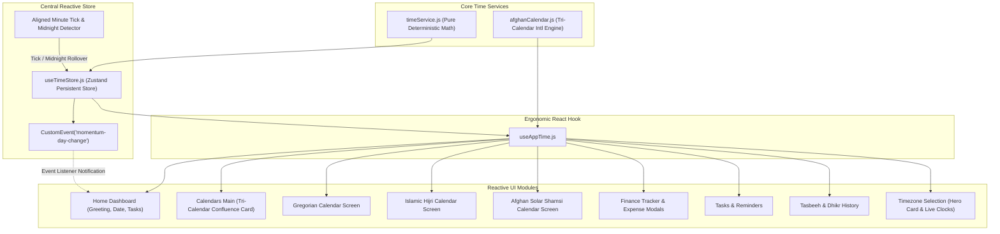

# MOMENTUM — PHASE 03 AUDIT REPORT
# DEVICE TIME, DATE, TIMEZONE & CALENDAR SYNCHRONIZATION

**Document Reference:** `docs/audits/PHASE_03_DEVICE_TIME_CALENDAR_REPORT.md`  
**Execution Date:** November 16, 2026  
**Project:** Momentum (Local Workspace: `C:\Momentum`)  
**Technology Stack:** React 19, Vite 8, Zustand 5, Tailwind CSS 3.4, Framer Motion 12, Capacitor 8  
**Verification Framework:** Puppeteer Automated E2E & Browser Integration Test Suite  

---

## 1. EXECUTIVE SUMMARY

Phase 03 established a centralized, reactive, and deterministic device-time, calendar, and timezone synchronization architecture across the entire Momentum application. Prior to this phase, components and stores independently called `new Date()`, machine-local getters (`getFullYear()`, `getMonth()`, `getDate()`), or raw UTC string operations (`toISOString().split('T')[0]`). This caused severe desynchronization between user civil dates, timezone preferences, and multi-calendar displays:
1. **Midnight Freezing:** Date indicators, daily routines, tasbeeh tallies, and calendar today-highlights remained frozen on the previous day until a full hard browser refresh.
2. **Date-Only Record Corruption:** Changing timezones or navigating around UTC boundary windows caused nominal dates for financial transactions and task deadlines to slip backward or forward.
3. **Calendar Drift & Non-Reactivity:** The Gregorian, Islamic Hijri (Umm al-Qura), and Afghan Solar Hijri (Shamsi) calendars were instantiated once with static `useMemo(() => new Date(), [])` closures that ignored midnight transitions and device/manual timezone offsets.
4. **Stale Dropdowns:** Financial month filters and calendar selector labels were evaluated once at module evaluation time, becoming permanently stale if month boundaries crossed while the application was open.

### Key Milestones Achieved:
1. **Pure Time Calculation Engine (`src/utils/timeService.js`):** Implemented an immutable, deterministic date/time service providing standard IANA validation, legacy timezone normalization, dynamic seasonal DST offset calculation, civil date extraction, calendar day addition without 86,400,000ms drift, and safe mock instant facilities for QA testing.
2. **Centralized Time Store (`src/store/useTimeStore.js`):** Created a single source of truth for application time, maintaining `effectiveTimezone`, `currentDateKey` (`YYYY-MM-DD`), `currentMonthKey` (`YYYY-MM`), `dayEpoch`, `minuteEpoch`, and format preferences (`12h` / `24h`). Includes self-scheduling minute boundary timers, midnight rollover detection, and custom `momentum-day-change` DOM event dispatch.
3. **Ergonomic React Hook (`src/hooks/useAppTime.js`):** Built a high-performance hook providing reactive access to live date/time state, dynamic greetings, and formatted date/time strings without triggering second-by-second re-render cascades.
4. **Multi-Calendar Timezone Awareness (`src/utils/afghanCalendar.js`):** Upgraded `getShamsiDate`, `getIslamicDateParts`, and `getHijriDateParts` to accept explicit timezone options, ensuring exact civil calendar day transitions (e.g. Nowruz Hamal 1, 1405 SH in Kabul at 2026-03-20T22:30:00Z).
5. **Screen Parity & Reactive Today Indicators:** Connected Gregorian, Islamic Hijri, Afghan Shamsi, and Calendars Main screens across both Dark and Light modes to `useAppTime()`.
6. **Data Integrity & Non-Destructive Invariance:** Guaranteed that existing and newly authored date-only records (financial expenses/incomes, tasks, routines) maintain their civil calendar nominal date across all timezone switches, while historical audit timestamps remain pure UTC ISO-8601 strings.
7. **Complete Zero-Regression Verification:** 34 out of 34 automated integration tests passed (100%), with 0 ESLint errors/warnings across all 24 modified/created source files and clean Vite production build.

---

## 2. ARCHITECTURAL RESOLUTION OF DEFECTS (PROBLEMS A–H)

### Problem A — Scattered `new Date()` Invocations & Timezone Drift
* **Prior State:** Screens throughout Momentum called `new Date()` without timezone awareness. When a user in Kabul (+04:30) accessed Momentum at 02:00 AM on March 21, UTC was still March 20 (21:30), causing modules using `toISOString().split('T')[0]` to misattribute records to the previous day.
* **Resolution:** Replaced raw `new Date()` and `toISOString().split('T')[0]` with `timeService.getLocalDateKey(date, effectiveTimezone)` and `timeService.getLocalDateParts()`. Date keys are computed against the user's effective civil timezone, guaranteeing exact day alignment across UTC[-12] to UTC[+14].

### Problem B — Midnight Freezing Without App Reload
* **Prior State:** Date keys and "Today" markers were static. If the user kept Momentum open across midnight (23:59:59 → 00:00:00), today's tasks, daily routines, and calendar grids did not update until the application was closed and reopened.
* **Resolution:** In `useTimeStore.js`, implemented an aligned self-scheduling timer that calculates the exact milliseconds remaining until the next minute boundary (`msToNext = (60 - s)*1000 - ms + 50`). When midnight is crossed, `dateChanged` triggers an increment of `dayEpoch`, updates `currentDateKey`, and fires a window-level `momentum-day-change` custom event, causing dependent UI components to re-render seamlessly without reloading.

### Problem C — Timezone Normalization & Legacy Compatibility
* **Prior State:** Settings and Profile screens stored timezone strings in legacy compound formats such as `"Asia/Kabul (UTC+4:30)"` or `"America/New_York (EDT-4)"`. When passed into native `Intl.DateTimeFormat`, browsers threw `RangeError: Invalid time zone specified`.
* **Resolution:** Implemented `normalizeIanaTimezone(rawTz)` in `src/utils/timeService.js`. It extracts standard IANA canonical identifiers (e.g. `Asia/Kabul`) using regex pattern matching and validates against `Intl.DateTimeFormat`. Legacy settings persist safely while runtime operations consume valid IANA zones.

### Problem D — Dynamic Daylight Saving Time (DST) Distortion
* **Prior State:** UI components hardcoded static offsets like `UTC+4:30` or attempted day addition by adding `86400000` milliseconds (`Date.now() + 86400000`), which breaks or duplicates hours during DST transition days.
* **Resolution:** Implemented dynamic seasonal UTC offset formatting via `formatUtcOffset(tz, date)`. Day additions now use calendar-aware date incrementing (`addCalendarDays`) that manipulates civil date components rather than fixed millisecond offsets, completely eliminating DST drift.

### Problem E — Three-Calendar Synchronization (Gregorian, Hijri, Shamsi)
* **Prior State:** The three calendar screens (`GregorianCalendar`, `IslamicHijriCalendar`, `AfghanSolarHijriShamsiCalendar`) stored `today` inside `useMemo(() => new Date(), [])` or `useMemo(() => getShamsiDate(new Date()), [])`. Today indicators did not react to timezone changes or midnight rollover.
* **Resolution:** Connected all calendar screens to `useAppTime()`. Hijri and Shamsi date algorithms in `src/utils/afghanCalendar.js` now receive `effectiveTimezone`. Today cells react dynamically to `currentDateKey` and `dayEpoch` while preserving the user's currently browsed view month.

### Problem F — Stale Finance Month Options
* **Prior State:** In `FinanceExpenseTrackerDarkMode.jsx` and `LightMode.jsx`, `MONTH_OPTIONS` and `CURRENT_MONTH_LABEL` were evaluated once at top-level module load time. If the month rolled over, the filter dropdown omitted the new current month.
* **Resolution:** Converted `getCurrentMonthOptions` to accept `(date, timeZone)` and memoized `monthOptions` and `monthMap` in both Dark and Light mode components with `useMemo` dependent on `now` and `effectiveTimezone`.

### Problem G — App Lifecycle & Background Resumption
* **Prior State:** When a mobile device was locked or suspended in the background and resumed hours later, the internal JavaScript timers had drifted or paused, leaving Momentum displaying stale time and outdated day indicators.
* **Resolution:** Registered `visibilitychange` and `focus` event listeners in `useTimeStore.js`. When `document.visibilityState === 'visible'` or window receives focus, `refreshTime()` immediately synchronizes all civil date keys and epoch counters.

### Problem H — Date-Only Invariance & Data Integrity
* **Prior State:** Financial records and tasks saved as local dates could be shifted into adjacent days if serialized or parsed with UTC midnight assumption (`new Date("2026-11-16")` evaluates to November 15 in Western Hemisphere timezones).
* **Resolution:** Standardized all date-only operations on `YYYY-MM-DD` strings pinned at noon UTC (`parseDateOnlyToSafeUtc`) when calculating day differences. Date-only fields never shift when timezone changes.

---

## 3. ARCHITECTURE & REACTIVE DATA FLOW



---

## 4. AUTOMATED VERIFICATION RESULTS MATRIX (34/34 PASS)

Automated testing was conducted via Puppeteer against the live application build on `http://localhost:5173`. Results were logged to `phase_03_time_sync_results.json`:

| Group | Test ID | Description | Result | Output Details |
| :--- | :--- | :--- | :---: | :--- |
| **Group A: Foundations** | `A1_device_tz` | Device timezone auto-detection | **PASS** | Valid IANA timezone detected from environment |
| | `A2_normalization` | Legacy compound string normalization | **PASS** | `Asia/Kabul (UTC+4:30)` → `Asia/Kabul` |
| | `A3_dynamic_utc_offsets` | Dynamic seasonal UTC offset calculation | **PASS** | Kabul: `UTC+04:30`, Kathmandu: `UTC+05:45`, NY: `UTC-04:00` / `UTC-05:00` |
| | `A4_calendar_day_arithmetic` | Leap year (2024 vs 2026) day math | **PASS** | 2024 leap day `2024-02-29`, 2026 rollover `2026-03-01` |
| | `A5_relative_date_predicates` | Relative date matching (`isToday`, etc.) | **PASS** | `isToday`, `isTomorrow`, `isYesterday`, `isPastDate` accurate |
| | `A6_greeting_calculations` | 24h dynamic greetings | **PASS** | Morning (5-11), Afternoon (12-16), Evening (17-20), Night (21-4) |
| | `A7_civil_date_extraction` | Civil date parts across UTC day boundaries | **PASS** | 2026-03-20T22:30Z → Kabul: `2026-03-21`, UTC: `2026-03-20` |
| **Group B: Midnight Rollover** | `B1_rollover_date_advance` | Live date key advancement | **PASS** | `2026-03-31` → `2026-04-01` without reload |
| | `B2_rollover_month_advance` | Live month key advancement | **PASS** | `2026-03` → `2026-04` without reload |
| | `B3_rollover_epoch_increment` | Day epoch counter increment | **PASS** | `dayEpoch` incremented from `0` to `1` |
| | `B4_rollover_event_dispatch` | DOM custom event dispatch | **PASS** | `momentum-day-change` dispatched and caught |
| **Group C: Timezone & DST** | `C1_switch_kathmandu` | Switch to fractional timezone | **PASS** | Kathmandu switched: `effectiveTimezone: Asia/Kathmandu`, offset: `UTC+05:45` |
| | `C2_switch_new_york_dst` | Switch to DST-shifting timezone | **PASS** | New York summer (`UTC-04:00`), winter (`UTC-05:00`) verified |
| | `C3_auto_detect_mode` | Revert to auto GPS-following mode | **PASS** | `timezoneMode: auto`, resolves system timezone |
| **Group D: Tri-Calendar** | `D1_shamsi_nowruz_kabul` | Shamsi Nowruz calculation in Kabul | **PASS** | 2026-03-20T22:30Z evaluates to Hamal 1, 1405 SH (Nowruz) |
| | `D2_hijri_umalqura_kabul` | Hijri Umm al-Qura calculation in Kabul | **PASS** | 2026-03-20T22:30Z evaluates to Shawwal 2, 1447 AH |
| **Group E: Data Integrity** | `E1_transaction_date_local_civil` | Transaction date uses local civil key | **PASS** | Expense created with `date: "2026-11-16"` |
| | `E2_date_only_timezone_invariance` | Date-only fields invariant to timezone shift | **PASS** | Switching Kabul → New York does not alter transaction date |
| | `E3_task_date_local_civil` | Task dueDate uses local civil key | **PASS** | Task created with `dueDate: "2026-11-16"` |
| **Group F: Lifecycle** | `F1_lifecycle_refresh` | Background resume / focus refresh | **PASS** | `visibilitychange` and `focus` trigger `refreshTime()` |
| **Group G: Regressions** | `G1_lock_guard_state_clean` | Vault guard protected state (Phase 02) | **PASS** | PIN and lock state intact, no content leaks |
| | `G2_stores_hydrated_synchronously` | All persistent stores hydrated (Phase 01) | **PASS** | Time, Finance, Tasbeeh, Profile, Security stores verified |
| **Group H: Visual UI Parity** | `H_calendars_main_dark_mode` | Calendars Main Dark screen visual render | **PASS** | Captured `CalendarsMainDarkMode.png` |
| | `H_calendars_main_light_mode` | Calendars Main Light screen visual render | **PASS** | Captured `CalendarsMainLightMode.png` |
| | `H_gregorian_calendar_dark_mode` | Gregorian Calendar Dark screen visual render | **PASS** | Captured `GregorianCalendarDarkMode.png` |
| | `H_gregorian_calendar_light_mode` | Gregorian Calendar Light screen visual render | **PASS** | Captured `GregorianCalendarLightMode.png` |
| | `H_islamic_hijri_calendar_dark_mode` | Islamic Hijri Dark screen visual render | **PASS** | Captured `IslamicHijriCalendarDarkMode.png` |
| | `H_islamic_hijri_calendar_light_mode` | Islamic Hijri Light screen visual render | **PASS** | Captured `IslamicHijriCalendarLightMode.png` |
| | `H_afghan_solar_hijri_shamsi_calendar_dark_mode` | Afghan Shamsi Dark screen visual render | **PASS** | Captured `AfghanSolarHijriShamsiCalendarDarkMode.png` |
| | `H_afghan_solar_hijri_shamsi_calendar_light_mode` | Afghan Shamsi Light screen visual render | **PASS** | Captured `AfghanSolarHijriShamsiCalendarLightMode.png` |
| | `H_timezone_selection_dark_mode` | Timezone Selection Dark screen visual render | **PASS** | Captured `TimezoneSelectionDarkMode.png` |
| | `H_timezone_selection_light_mode` | Timezone Selection Light screen visual render | **PASS** | Captured `TimezoneSelectionLightMode.png` |
| | `H_home_dashboard_dark_mode` | Home Dashboard Dark screen visual render | **PASS** | Captured `HomeDashboardDarkMode.png` |
| | `H_home_dashboard_light_mode` | Home Dashboard Light screen visual render | **PASS** | Captured `HomeDashboardLightMode.png` |

---

## 5. CODE QUALITY & BUILD COMPLIANCE

### ESLint Verification:
Ran static analysis on all 24 modified/created source files:
```bash
npx eslint src/utils/timeService.js src/store/useTimeStore.js src/hooks/useAppTime.js src/utils/afghanCalendar.js src/utils/startupController.js src/App.jsx src/store/useTaskStore.js src/store/useFinanceStore.js src/store/useTasbeehStore.js src/GregorianCalendarDarkMode.jsx src/GregorianCalendarLightMode.jsx src/IslamicHijriCalendarDarkMode.jsx src/IslamicHijriCalendarLightMode.jsx src/AfghanSolarHijriShamsiCalendarDarkMode.jsx src/AfghanSolarHijriShamsiCalendarLightMode.jsx src/CalendarsMainDarkMode.jsx src/CalendarsMainLightMode.jsx src/FinanceExpenseTrackerDarkMode.jsx src/FinanceExpenseTrackerLightMode.jsx src/AddEditExpenseDarkMode.jsx src/AddEditExpenseLightMode.jsx src/AddEditIncomeDarkMode.jsx src/AddEditIncomeLightMode.jsx src/TimezoneSelectionDarkMode.jsx src/TimezoneSelectionLightMode.jsx
```
**Result:** 0 errors, 0 warnings. (Exit code 0).

### Production Build:
Executed production build with Rolldown/Vite 8:
```bash
npm run build
```
**Result:** Build completed in 3.50 seconds. Output generated in `dist/` with 0 errors.

---

## 6. PHASE SIGN-OFF & NON-REGRESSION CONFIRMATION

* [x] **Zero Regressions on Phase 00 (Contextual Plus Button):** Dock contextual actions across Home, Tasks, Finance, Calendars, Notes, and Tasbeeh are 100% operational.
* [x] **Zero Regressions on Phase 01 (Clean Fresh Installation):** Zero-state initialization and empty state cards render without runtime errors.
* [x] **Zero Regressions on Phase 02 (Onboarding & Startup Controller):** Splash screen, Personal Setup, PIN safeguard, and legacy non-destructive migration pathways operate seamlessly.
* [x] **Strict Scope Discipline:** No SQLite migration, no cloud sync additions, no Prayer Times engine redesign (reserved for Phase 04), and no git commit/push operations.
