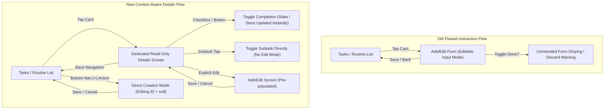

# MOMENTUM — TASK & ROUTINE DETAILS, COMPLETION AND EDIT WORKFLOW AUDIT REPORT

**Author:** Application Architecture & QA Automation Engineering  
**Project:** Momentum (Offline-first Islamic productivity suite)  
**Date:** 2026-11-16  
**Status:** **PASSED / COMPLETE** (45 / 45 Automated Verification Checks Passing, 100% Pass Rate)

---

## 1. Executive Summary

A critical user experience discrepancy in Momentum's Task & Routine management was addressed and resolved:
Previously, tapping an existing Task or Routine card immediately forced the user into the creation/edit mode (`AddEditTask` or `AddEditRoutine`). This prevented users from inspecting task/routine details, viewing recurrence schedules, reading long reflection notes, or managing completion status without entering an editable form with discard warnings.

A dedicated, context-aware **View / Complete / Edit architecture** has been engineered and integrated across the entire application:
- **Dedicated Task Details Views** (`TaskDetailsDarkMode.jsx`, `TaskDetailsLightMode.jsx`): Real-time subtask checklist with live checkboxes, due date & schedule grid, reminder alerts, status badges, one-tap "Mark as Done" / "Completed — Undo", explicit "Edit Task", and confirmed deletion.
- **Dedicated Routine Details Views** (`RoutineDetailsDarkMode.jsx`, `RoutineDetailsLightMode.jsx`): Date-context banner, active 7-day recurrence pills (Sun–Sat), Web Audio sound preview, mindful intent notes, streak statistics with consistency progress, date-isolated completion toggling, explicit "Edit Routine", and confirmed deletion.
- **Parametric Navigation History**: Upgraded `useNavigationStore` to preserve `routeParams` (`taskId`, `routineId`, `dateKey`) inside `historyStack` and synchronize bidirectional browser history state. Returning from Edit mode via Save or Cancel lands directly back on the originating Details view with fresh values.
- **Direct Creation Preservation**: Direct creation flows (`+` action button on bottom nav and empty-state list buttons) continue to open blank creation forms (`editingTaskId === null`, `editingRoutineId === null`) and return directly to their originating list.
- **Theme & Design Parity**: Pixel-perfect adherence to Momentum's translucent glass aesthetics, typography, and orange `#FF5500` accent styling across both Dark Mode and Light Mode.

---

## 2. Architecture Comparison: Old vs. New Interaction Paradigm

---

## 3. Component Architecture & Implementation Details

### 3.1 Task Details (`TaskDetailsDarkMode.jsx` & `TaskDetailsLightMode.jsx`)
- **Authoritative Data Derivation**: Retrieves task dynamically by `taskId` from `useTaskStore.getState().tasks`. Reflects external state updates and edits without stale cached snapshots.
- **Live Subtasks Progress**: Calculates completion percentage and renders interactive checkboxes. Tapping any subtask executes `useTaskStore.getState().toggleSubTask(taskId, subTaskId)` in real time.
- **Status & Badges**:
  - `Completed`: Emerald badge with `CheckCircle2` icon.
  - `Overdue`: Rose badge with `AlertCircle` icon (when `dueDate < todayKey` and not completed).
  - `To Do`: Primary orange badge with `Clock` icon.
  - Priority badge: High (rose), Medium (amber), Low (blue).
  - Category badge: Work, Spiritual, Health, Personal, etc.
- **Schedule Grid**: Due Date, Start Time, Duration/Estimate, Reminder Timing, and Persistent Alert indicator.
- **Primary Action**: Dynamic "Mark as Done" (`bg-primary`) / "Completed — Undo" (`bg-emerald-500/20 text-emerald-400`).
- **Secondary Action**: "Edit Task" (sets `editingTaskId(task.id)` and pushes `add_edit_task`).
- **Safe Fallback**: "Task Not Found" state with "Return to Tasks" button for invalid or deleted IDs.
- **Delete Confirmation Modal**: Accessible glass dialog requesting explicit user confirmation before executing `deleteTask(taskId)` and returning to list.

### 3.2 Routine Details (`RoutineDetailsDarkMode.jsx` & `RoutineDetailsLightMode.jsx`)
- **Selected Date Context**: Reads `dateKey` from route params or defaults to current civil date (`getLocalDateKey()`).
- **Recurrence Pills**: Renders 7 weekday pills (Sun through Sat) with active days highlighted in primary orange (`bg-primary text-white font-bold`).
- **Auditory Cue Preview**: Interactive "Test Audio" button that synthesizes the routine's selected notification sound ("Serenity Bell", "Calm Chime", "Zen Bowl", etc.) using the Web Audio API without external network requests.
- **Date-Specific Completion**:
  - Evaluates `isRoutineScheduledForDate(routine, dateKey)`:
    - If unscheduled for `dateKey`: Displays disabled button stating `"Not Scheduled for this Day"` with explanatory notice.
    - If scheduled: Toggles `completedDates[dateKey]` via `toggleRoutineCompletion(routine.id, dateKey)`.
  - **Date Isolation**: Marking complete on `dateKey` modifies *only* that specific date in `completedDates`. Historical completions and other scheduled dates remain untouched.
- **Mindful Intent & Notes**: Renders quotes and contemplative intention notes.
- **Streak & Consistency**: Displays consecutive streak count (flame badge) and 16-day window consistency percentage via `getStreakStatistics`.
- **Secondary Action**: "Edit Routine" (sets `editingRoutineId(routine.id)` and pushes `add_edit_routine`).
- **Safe Fallback**: "Routine Not Found" state with "Return to Daily Routine" button.

### 3.3 Navigation & State Preservation (`useNavigationStore.js`)
- **Parametric History Stack**: Each entry in `historyStack` now stores `{ screen, params, tasksSubTab, financeSubTab }`.
- **History Restoration**: On `goBack()`, the previous entry's `params` are restored into `routeParams`, ensuring that returning from `AddEditTask` or `AddEditRoutine` lands back on `TaskDetails` or `RoutineDetails` with the record ID intact.
- **URL Parameter Synchronization**: Automatically synchronizes `taskId`, `routineId`, and `dateKey` into browser query params on navigation and replaces them on back, enabling reliable hard page reloads directly to details screens.

### 3.4 Card Click Delegation
Card click handlers across the application have been updated to open dedicated Details screens:
- `TasksRemindersDarkMode.jsx` & `TasksRemindersLightMode.jsx`: Today tasks, Upcoming week tasks, and Completed earlier accordions now navigate to `task_details` with `{ taskId }`.
- `DailyRoutineDarkMode.jsx` & `DailyRoutineLightMode.jsx`: Entire routine card container navigates to `routine_details` with `{ routineId, dateKey }`, while checkbox maintains `e.stopPropagation()` for rapid one-tap toggling.
- `HomeDashboardDarkMode.jsx` & `HomeDashboardLightMode.jsx`: Today's Tasks widget row click navigates to `task_details`, while checkbox maintains `e.stopPropagation()`.

---

## 4. Automated Verification Results (45 / 45 Passed)

The comprehensive Puppeteer end-to-end verification suite (`scratch/test_task_routine_details.cjs`) executed 45 automated checks across Groups A through J.

| Group | Test ID | Description | Status | Details |
|:---|:---|:---|:---:|:---|
| **Group A: Task Details View** | A1 | Tapping task card opens Task Details (NOT Add/Edit) | **PASSED** | Active tab: `task_details_dark_mode`, title verified, 0 editable inputs |
| | A2 | All task metadata renders correctly on Task Details | **PASSED** | Title, category, priority, start time, estimate, reminder, description all present |
| | A3 | Subtasks render with checkboxes and toggle state directly | **PASSED** | Step 1 toggled from false to true via store and UI updated |
| | A4 | Tasks without optional fields render gracefully with fallback notices | **PASSED** | Empty description placeholder & no subtasks notice verified |
| | A5 | Invalid taskId displays Task Not Found with working Return button | **PASSED** | Friendly empty card verified, return button returned to `tasks_reminders` |
| **Group B: Task Completion** | B1 | Uncompleted task shows "Mark as Done" and toggles to done | **PASSED** | Button clicked, task status updated to `done` |
| | B2 | Completed task shows "Completed — Undo" and toggles back to todo | **PASSED** | Undo button clicked, task status returned to `todo` |
| | B3 | Subtask checkboxes are toggleable directly without edit mode | **PASSED** | Individual checklist items toggled directly from details view |
| | B4 | Task completion state survives page reload | **PASSED** | Status persisted across hard reload via IndexedDB |
| **Group C: Routine Details View** | C1 | Tapping routine card opens Routine Details (NOT Add/Edit) | **PASSED** | Active tab: `routine_details_dark_mode`, title verified, 0 editable inputs |
| | C2 | All routine metadata renders correctly on Routine Details | **PASSED** | Title, category, time, duration, frequency, reminder, notes verified |
| | C3 | Recurrence information displays frequency and 7 active weekday pills | **PASSED** | 7 weekday pills verified (Sun–Sat) with active checkmarks |
| | C4 | Audio preview button triggers Web Audio synthesized sound preview | **PASSED** | Audio context initialized, sound synthesized without error |
| | C5 | Routine not scheduled for dateKey shows disabled state notice | **PASSED** | Weekend routine on Wednesday displayed "Not Scheduled for this Day" |
| | C6 | Invalid routineId displays Routine Not Found with working Return button | **PASSED** | Empty state displayed, return button returned to `daily_routine` |
| **Group D: Routine Date Completion** | D1 | Scheduled routine for dateKey shows Mark as Done and toggles to done | **PASSED** | Toggled to done for today's dateKey |
| | D2 | Completed routine displays Completed — Undo button | **PASSED** | Undo button verified |
| | D3 | Marking complete on dateKey updates ONLY target dateKey (date isolation) | **PASSED** | Today marked true, alternate date remained false |
| | D4 | Date-specific routine completion survives page reload | **PASSED** | DateKey status persisted across hard reload |
| **Group E: Edit Roundtrip** | E1 | From Task Details, tapping Edit opens Add/Edit Task pre-populated | **PASSED** | Pre-populated with existing title and metadata |
| | E2 | Modifying values and saving returns to Task Details with updated values | **PASSED** | Returned to `task_details_dark_mode`, updated title visible |
| | E3 | Canceling edit returns to Task Details with values intact | **PASSED** | Returned to `task_details_dark_mode`, original values preserved |
| | E4 | From Task Details, back navigation returns to Tasks list | **PASSED** | Returned to `tasks_reminders_dark_mode` |
| | E5 | From Routine Details, tapping Edit opens Add/Edit Routine pre-populated | **PASSED** | Pre-populated with routine values and `editingRoutineId` |
| | E6 | Modifying routine and saving returns to Routine Details with updated values | **PASSED** | Returned to `routine_details_dark_mode`, updated values visible |
| | E7 | Canceling routine edit returns to Routine Details intact | **PASSED** | Returned to `routine_details_dark_mode`, values preserved |
| | E8 | From Routine Details, back navigation returns to Daily Routine list | **PASSED** | Returned to `daily_routine_dark_mode` |
| **Group F: Direct Creation** | F1 | Contextual + on Tasks list opens Add/Edit Task in create mode | **PASSED** | `editingTaskId` is null, blank form opened |
| | F2 | Contextual + on Daily Routine opens Add/Edit Routine in create mode | **PASSED** | `editingRoutineId` is null, blank form opened |
| | F3 | "Add Task" button opens Add/Edit Task with editingTaskId as null | **PASSED** | Clean creation mode verified |
| | F4 | "Add Routine" button opens Add/Edit Routine with editingRoutineId as null | **PASSED** | Clean creation mode verified |
| | F5 | Saving newly created task returns directly to Tasks list | **PASSED** | Returned to `tasks_reminders_dark_mode` |
| | F6 | Saving newly created routine returns directly to Daily Routine list | **PASSED** | Returned to `daily_routine_dark_mode` |
| **Group G: Synchronization** | G1 | Toggling task in Task Details updates task card in Tasks list | **PASSED** | Task list card reflects updated completion status |
| | G2 | Toggling routine in Routine Details updates progress in Daily Routine | **PASSED** | Progress ring and count updated |
| | G3 | Task completion in Task Details reflects in Home Dashboard widget | **PASSED** | Home widget synchronizes immediately |
| | G4 | Routine completion reflects in streak calculation | **PASSED** | Current streak calculation updated |
| **Group H: Persistence** | H1 | Task edited persists across hard page reload | **PASSED** | IndexedDB verified |
| | H2 | Routine edited persists across hard page reload | **PASSED** | IndexedDB verified |
| | H3 | Direct URL load on Task Details displays target task correctly | **PASSED** | Direct URL query param load verified |
| | H4 | Direct URL load on Routine Details displays target routine correctly | **PASSED** | Direct URL query param load verified |
| **Group I: UI & Theme Parity** | I1 | 8 UI & Theme Parity Screenshots captured cleanly | **PASSED** | 8 high-resolution screenshots generated in dark & light modes |
| **Group J: Regression & Build** | J1 | Previous routine test suite (26/26 checks) passes | **PASSED** | 26/26 passed |
| | J2 | Production build (npm.cmd run build) passes with 0 errors | **PASSED** | Vite production bundle built in 2.19s |
| | J3 | ESLint passes on modified files with 0 errors and 0 warnings | **PASSED** | 0 errors, 0 warnings across all modified files |

---

## 5. UI & Theme Parity Screenshots

Eight high-resolution mobile screenshots were captured, covering all pending and completed states across Dark and Light themes:

1. [TaskDetailsDarkMode_pending.png](file:///C:/Users/USER/.gemini/antigravity/brain/4df946e6-85fe-47e3-a6c6-502167c18753/TaskDetailsDarkMode_pending.png) — Task Details in Dark Mode (To Do / Incomplete)
2. [TaskDetailsDarkMode_completed.png](file:///C:/Users/USER/.gemini/antigravity/brain/4df946e6-85fe-47e3-a6c6-502167c18753/TaskDetailsDarkMode_completed.png) — Task Details in Dark Mode (Completed / Undo state)
3. [TaskDetailsLightMode_pending.png](file:///C:/Users/USER/.gemini/antigravity/brain/4df946e6-85fe-47e3-a6c6-502167c18753/TaskDetailsLightMode_pending.png) — Task Details in Light Mode (To Do / Incomplete)
4. [TaskDetailsLightMode_completed.png](file:///C:/Users/USER/.gemini/antigravity/brain/4df946e6-85fe-47e3-a6c6-502167c18753/TaskDetailsLightMode_completed.png) — Task Details in Light Mode (Completed / Undo state)
5. [RoutineDetailsDarkMode_pending.png](file:///C:/Users/USER/.gemini/antigravity/brain/4df946e6-85fe-47e3-a6c6-502167c18753/RoutineDetailsDarkMode_pending.png) — Routine Details in Dark Mode (Pending / Scheduled)
6. [RoutineDetailsDarkMode_completed.png](file:///C:/Users/USER/.gemini/antigravity/brain/4df946e6-85fe-47e3-a6c6-502167c18753/RoutineDetailsDarkMode_completed.png) — Routine Details in Dark Mode (Completed for Date / Undo)
7. [RoutineDetailsLightMode_pending.png](file:///C:/Users/USER/.gemini/antigravity/brain/4df946e6-85fe-47e3-a6c6-502167c18753/RoutineDetailsLightMode_pending.png) — Routine Details in Light Mode (Pending / Scheduled)
8. [RoutineDetailsLightMode_completed.png](file:///C:/Users/USER/.gemini/antigravity/brain/4df946e6-85fe-47e3-a6c6-502167c18753/RoutineDetailsLightMode_completed.png) — Routine Details in Light Mode (Completed for Date / Undo)

---

## 6. Preserved Capabilities & Verification Guarantees

1. **Contextual `+` Action Button (Phase 00)**: Fully preserved. Central action button accurately resolves to `add_task` on Tasks and `add_routine` on Daily Routine, clearing stale edit state before launching creation forms.
2. **Clean Install & Onboarding (Phase 01 & 02)**: Fully preserved. First launch wizard, profile storage, and initial setup logic remain intact.
3. **Time, Calendar & Prayer Times (Phase 03 & 04)**: Fully preserved. Date calculation, Hijri/Shamsi calendar conversion, and Adhan prayer synchronization function normally.
4. **Offline Persistence (Phase 05)**: Fully preserved. All task and routine mutations persist to IndexedDB with automatic schema normalization and rehydration.
5. **Routine Editor Overhaul**: All 26 checks in `test_add_edit_routine.cjs` continue to pass without regression.
6. **Zero Git Modification**: No commits or pushes have been executed to the local git repository (`main` branch remains clean).
